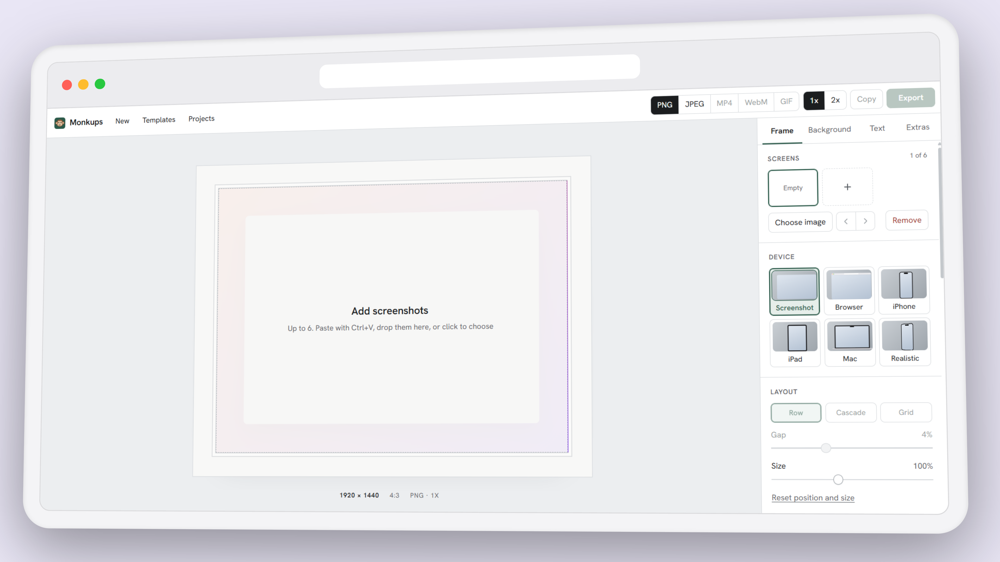
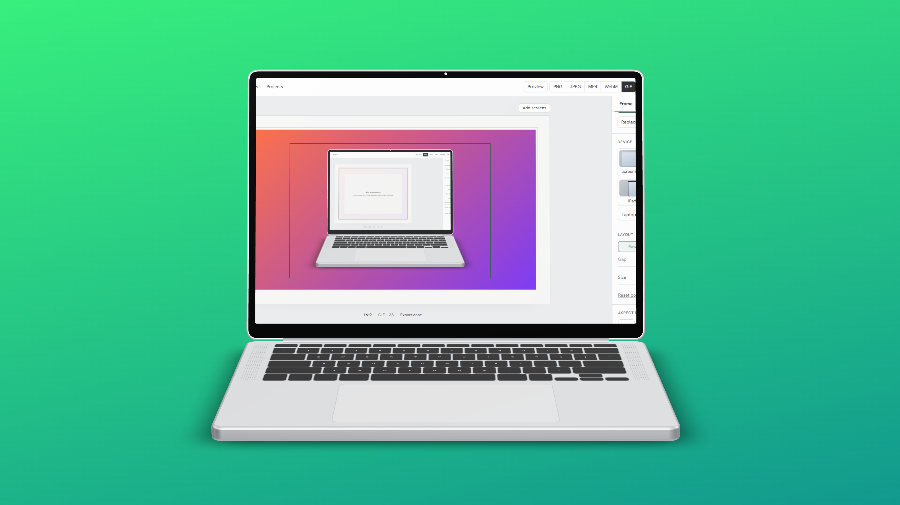
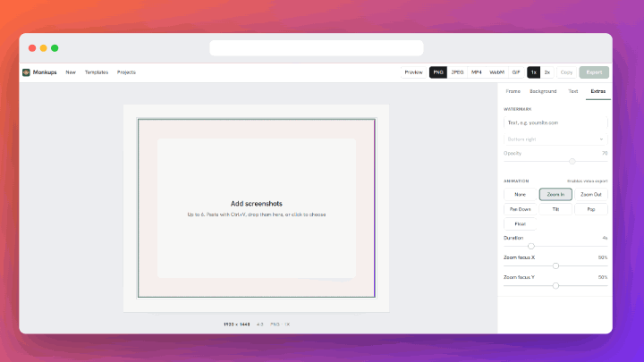

<div align="center">


# Monkups

**Turn a screenshot into a finished mockup in seconds, right in your browser.**

Device frames, backgrounds, 3D rotation, overlays and animations, exported as PNG, JPEG, MP4, WebM or GIF.
No backend, no accounts, no tracking: everything stays on your machine.


</div>

---

<!-- Screenshot: main editor. Save it as docs/screenshots/editor.png -->
<p align="center">
  
</p>

## Table of contents

- [Features](#features)
- [Screenshots](#screenshots)
- [Getting started](#getting-started)
- [Scripts](#scripts)
- [Usage](#usage)
- [Unsplash backgrounds](#unsplash-backgrounds)
- [Designing from Claude Code (MCP)](#designing-from-claude-code-mcp)
- [Project structure](#project-structure)
- [Tech stack](#tech-stack)
- [License](#license)

## Features

| | |
| --- | --- |
| 📱 **Device frames** | Plain screenshot, iPhone, iPad, MacBook, and Safari/Chrome browser windows in light and dark. |
| 🧊 **3D devices** | Phone and laptop rendered with Three.js, with angle presets. |
| 🖼️ **Backgrounds** | Transparent, solid colours, gradients, your own images (with blur) or Unsplash photos. |
| 📐 **Layouts and ratios** | Several screens per design and nine aspect ratios: 4:3, 1:1, 4:5, 3:4, 2:3, 9:16, 16:9, 3:2 and 5:4. |
| ✍️ **Overlays** | Text, CTA buttons and logos above the screens, plus a watermark. |
| 🎬 **Animations** | Zoom in, zoom out, pan down, tilt, pop and float. |
| 📤 **Export** | PNG/JPEG at 1x or 2x, to a file or the clipboard. MP4, WebM and GIF when an animation is active. |
| 💾 **Templates and projects** | Saved locally in IndexedDB. Nothing is uploaded. |
| 🤖 **MCP server** | Lets Claude Code read, edit and preview the open design during development. |

## Screenshots

| 3D devices | Animated export |
| :---: | :---: |
|  |  |

## Getting started

### Prerequisites

- **Node.js 20.19+ or 22.12+**, which Vite 8 requires.
- **pnpm**. The exact version is pinned in `package.json` (`packageManager`), so the easiest way is Corepack:

  ```bash
  corepack enable
  ```

- A Chromium-based browser is recommended. Video export uses the **WebCodecs** API.

### Installation

```bash
git clone https://github.com/javiimiralles/monkups.git
cd monkups
pnpm install
```

### Run it

```bash
pnpm dev
```

Then open <http://localhost:5173>.

## Scripts

| Command | What it does |
| --- | --- |
| `pnpm dev` | Starts the Vite dev server with hot reload and the MCP endpoint. |
| `pnpm build` | Type-checks with `tsc` and builds a static site into `dist/`. |
| `pnpm preview` | Serves the production build locally. |
| `pnpm test` | Runs the unit tests with Vitest. |

The production build is a plain static site. You can host `dist/` anywhere, such as GitHub Pages, Netlify or any web server.

## Usage

1. **Add a screenshot** with the file picker, by dragging it onto the stage, or by pasting it with <kbd>Ctrl</kbd> + <kbd>V</kbd>.
2. **Adjust it** from the sidebar: device, frame style, background, layout, 3D angle, overlays and animation.
3. **Export it** with the **Export** button in the top bar.

| Shortcut | Action |
| --- | --- |
| <kbd>Ctrl</kbd> + <kbd>V</kbd> | Paste a screenshot |
| <kbd>Enter</kbd> | Edit the selected text overlay |
| <kbd>Delete</kbd> / <kbd>Backspace</kbd> | Remove the selected overlay |
| <kbd>Esc</kbd> | Stop editing, or close the library |

Use **Templates** and **Projects** in the top bar to save your work and reopen it later. It is stored in your browser's IndexedDB.

## Unsplash backgrounds

Unsplash search is optional and uses your own key. No environment variables are needed.

1. Create an app at [unsplash.com/developers](https://unsplash.com/developers) and copy its **Access Key**.
2. In Monkups, open the Unsplash background picker and paste the key.

The key is saved in your browser's `localStorage`. Searching Unsplash is the only time Monkups talks to an outside service.

## Designing from Claude Code (MCP)

In development, the Vite dev server also exposes an [MCP](https://modelcontextprotocol.io) server at `http://localhost:5173/mcp`. Claude Code can use it to work on the design that is open in your browser.

The repository already includes `.mcp.json`, so you only need to:

1. Run `pnpm dev`.
2. Open <http://localhost:5173> in a browser. The tools answer from that tab.
3. Start Claude Code in the project folder and approve the `monkups` server.

| Tool | Description |
| --- | --- |
| `get_design` | Returns the current design: screens, layout, ratio, frame, background, scene, watermark, animation and overlays. |
| `apply_design` | Changes the design. Send only the keys you want to change. |
| `get_preview` | Returns a PNG render of the current design. |

> [!NOTE]
> The MCP bridge only runs in development and is left out of production builds. It accepts requests from localhost only.

## Project structure

```text
monkups/
├── public/            Static assets (favicon / logo)
├── src/
│   ├── components/    React UI: Stage, Sidebar, DeviceFrame, Library, pickers
│   ├── domain/        Pure logic: devices, layouts, styles, animations, overlays
│   ├── export/        Image and video export (PNG/JPEG, MP4/WebM/GIF)
│   ├── render3d/      Three.js phone and laptop models and renderer
│   ├── services/      IndexedDB projects and the Unsplash client
│   ├── state/         Zustand editor store
│   ├── mcp/           Dev-only MCP server and browser bridge
│   ├── App.tsx
│   └── main.tsx
├── render3d.html      Visual harness for the 3D devices (open at /render3d.html)
├── DESIGN.md          Design system
└── PRODUCT.md         Product scope and principles
```

## Tech stack

- **[React 19](https://react.dev)** and **[TypeScript](https://www.typescriptlang.org)**, built with **[Vite](https://vite.dev)**
- **[Zustand](https://zustand.docs.pmnd.rs)** for state and **[Zod](https://zod.dev)** for schemas
- **[Three.js](https://threejs.org)** for the 3D devices
- **[modern-screenshot](https://github.com/qq15725/modern-screenshot)** for image export
- **[Mediabunny](https://mediabunny.dev)** and **[gifenc](https://github.com/mattdesl/gifenc)** for video and GIF export
- **[Vitest](https://vitest.dev)** for tests

## License

Released under the [MIT License](LICENSE).

---

<div align="center">
<sub>Made with 🐒 and a lot of screenshots.</sub>
</div>
